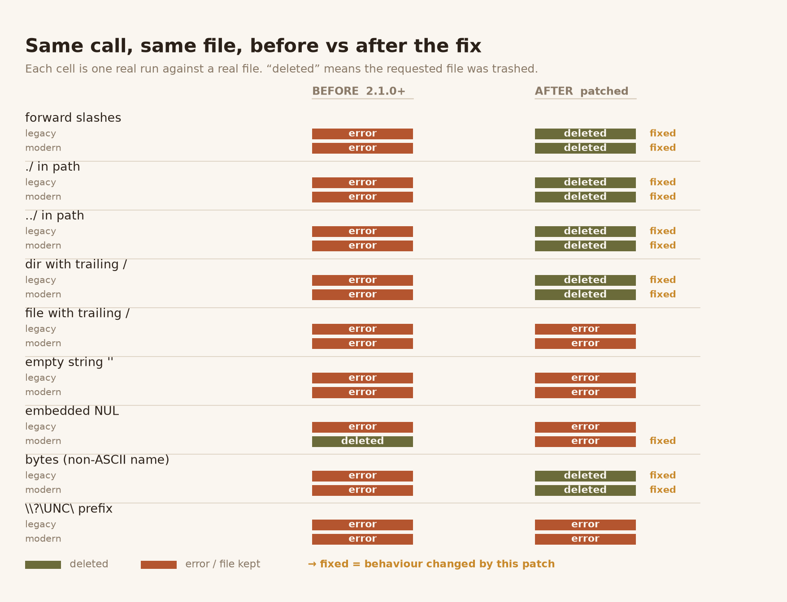
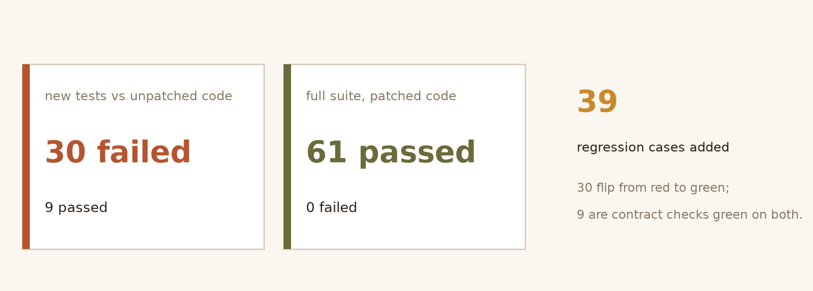
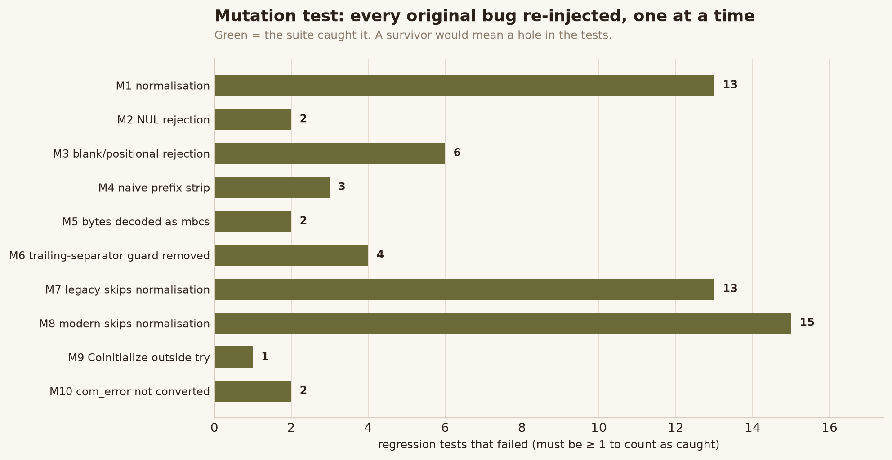

# send2trash — Windows path handling audit and fix

A security audit of [send2trash](https://github.com/arsenetar/send2trash) focused on
**input validation, path handling and resource release** on Windows, with six reproduced
defects, a fix, and a regression suite that fails on the unfixed code.

> **This is a modified copy, not the upstream project.** See [NOTICE.md](NOTICE.md).
> Upstream: [`arsenetar/send2trash`](https://github.com/arsenetar/send2trash) at commit
> [`522bafe`](https://github.com/arsenetar/send2trash/commit/522bafebc8075644d1ce66d03047aafb994ad615)
> (2.1.0 + 3 commits). Licence: BSD 3-Clause, Copyright (c) 2017 Virgil Dupras, unchanged.

---

## Why this project

`send2trash` exists to **delete** files. Its callers are almost always responding to a user
pressing Delete, so path resolution is not a detail of its implementation — it *is* its
safety property. A path that silently resolves somewhere else is worse than an error.

The package ships two independent Windows backends (`SHFileOperationW` via ctypes, and
`IFileOperation` via pywin32) that each parsed paths on their own, with no shared
normalisation step. Upstream had already fixed one defect of exactly this class
(`522bafe`, a substring false-match in POSIX `is_parent()`), but that fix never touched
Windows.

---

## Findings

All six were reproduced against real files in a throwaway directory. None comes from a
scanner.

| # | Defect | Severity | Observed |
|---|---|---|---|
| 1 | Absolute paths skipped normalisation (`abspath` only ran for *relative* input) | Functional | `/` separators, `./`, `../`, doubled separators and a trailing separator were forwarded verbatim; both backends rejected them | 
| 2 | Empty path resolved to the working directory | High | `send2trash('')` asked the shell to recycle the process CWD; POSIX raises `ENOENT` for the same call |
| 3 | `\\?\UNC\` prefix sliced into a *relative* path | High | `path[4:]` turned `\\?\UNC\srv\share\f` into `UNC\srv\share\f`, which resolves against the CWD |
| 4 | Embedded NUL truncated the path | **Critical** | **Actually deleted the wrong target**: `'real.txt\0junk'` trashed `real.txt` and reported success |
| 5 | `bytes` decoded with the ANSI codepage | Medium | PEP 529 made the Windows FS encoding UTF-8; `mbcs` mangled every non-ASCII name |
| 6 | `CoInitialize` outside the `try` | Medium | A failure in between leaked the apartment reference count forever, and escaped as `com_error`, which is **not** an `OSError` |



Severity is stated conservatively. Only #4 was observed destroying a file. #2 and #3 were
blocked **by the operating system, not by the library** — the CWD happened to be in use, and
the shell refused the relative path. They are filed as missing input validation, not as
demonstrated exploits, because the defence is incidental rather than designed.

---

## The fix

Path normalisation moved into one place both backends call before touching any system API:

```python
# send2trash/win/legacy.py, send2trash/win/modern.py
paths = [normalize_win32_path(path) for path in paths]
```

`normalize_win32_path()` in `send2trash/util.py` now:

- decodes `bytes` with `os.fsdecode` (the filesystem encoding) instead of `mbcs`;
- rejects an embedded NUL with `ValueError`;
- rejects `''`, `'.'` and `'..'` with `ENOENT`, matching Freedesktop behaviour;
- always normalises (`normpath(abspath(path))`), so separators and dot components are resolved;
- keeps a trailing separator only for directories — stripping it unconditionally would
  turn `'file.txt/'` into a request to delete `file.txt`;
- translates `\\?\` instead of slicing it: `\\?\UNC\` → `\\`, `\\?\X:\` → `X:\`, and keeps
  the prefix for forms with no plain spelling such as `\\?\Volume{GUID}\`.

`modern.py` also pairs `CoInitialize` with exactly one `CoUninitialize` and routes its whole
COM body through `_delete_items()`, whose `com_error` conversion now covers
`CoCreateInstance` and `SetOperationFlags` too.

**Scope:** three source files. `plat_other.py`, `plat_gio.py`, `mac/*`, `win/__init__.py`,
`win/IFileOperationProgressSink.py`, `__init__.py`, `__main__.py` and `exceptions.py` are
byte-for-byte identical to upstream, so POSIX and macOS behaviour is unchanged.

---

## Tests



39 regression cases run both Windows backends against real files. They were written
*failing first*: against the unpatched tree, 30 of them fail.

```
$ python -m pytest tests -q
61 passed, 1 skipped

$ python -m flake8 send2trash tests
(no output)
```

### Mutation testing

Each original bug was re-injected into the **patched** tree, one at a time; the suite must
go red.



```
Mutation score: 10/10
```

Every kill was confirmed to be a real test failure, not a crash. The first round scored
7/10 and **two of the "kills" were false positives** — the mutants were syntactically
invalid, so pytest exited non-zero with `0 failed`. See
[AUDIT_REPORT.md §8.1](AUDIT_REPORT.md).

---

## Reproduction

```bash
python -m venv .venv
.venv/Scripts/pip install pytest flake8 pywin32     # Windows

.venv/Scripts/python -m pytest tests -q             # 61 passed, 1 skipped
.venv/Scripts/python -m flake8 send2trash tests      # clean

# The figures on this page, regenerated from the saved run output
.venv/Scripts/pip install matplotlib
.venv/Scripts/python bench/make_figures.py
```

`audit/` holds the raw output of the runs quoted above: `test_run.txt`, `flake8.txt`,
`differential.txt`, `mutation.txt`, `baseline_failures.txt`.

---

## What is *not* covered

Honest limits of this audit:

- **macOS and Linux were not exercised.** Their code is byte-identical to upstream, so the
  claim of "no impact" rests on a diff, not on a run.
- **`plat_other.py` has related weaknesses left untouched**: `op.exists()` as a pre-flight
  check, and a `counter`-based name-collision loop that can race. Out of scope here —
  no POSIX host was available to verify a fix.
- **`\\?\` translation covers three forms only.** Case-mixed `\\?\unc\` falls through to
  "keep the prefix", which fails loudly rather than deleting the wrong file — safe, but
  incomplete.
- **No fuzzing, no concurrency testing.** The multi-path semantics (queue all items, then
  `PerformOperations()`) were not audited.

Full detail, including the three methodology mistakes made along the way, is in
[AUDIT_REPORT.md](AUDIT_REPORT.md).
